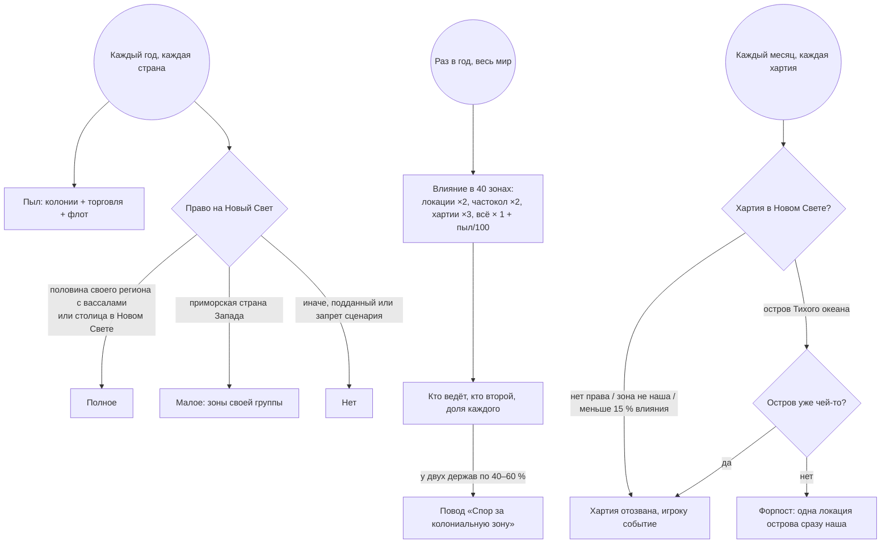

# Geopolicy: колониальный этап, часть 1 (v0.11.0, 2026-11-08)

По ответам автора от 2026-11-08 на вопросы из [GEOPOLICY_COLONIES_PROPOSAL.md](GEOPOLICY_COLONIES_PROPOSAL.md). Код: `in_game/common/scripted_effects/gp_colonies.txt`, зоны — `gp_colonial_zones.txt` (собирает `tools/gen_colonial_zones.pl`), условия — `scripted_triggers/gp_colonial_triggers.txt`, числа — `script_values/gp_col_values.txt`. Правило игры «Колониальный этап» (`gp_rule_colonies`) выключает всё сразу.

## 1. Ответы автора

| Вопрос | Ответ | Как сделано |
|---|---|---|
| От чего растёт пыл | от числа колоний, торговли и флота | три части: колонии до 40, торговля до 30, флот до 30 (§3) |
| Кто борется за зону | Новый Свет колонизируют только страны, которые объединили регион или доминируют в нём; Дания — только север и Канада, Нидерланды — свой регион | полное право (половина своего региона с вассалами) и малое право по группам (§4) |
| Разделить Северную Германию на Бенилюкс и Северную Германию | — | ванильный регион остаётся (на него ссылаются 46 файлов игры: формируемые, миссии, события), мод считает пять областей Нидерландов своей «зоной Бенилюкса» для колониального права |
| Кому колонии рухнувшей Британии | становятся независимыми; Испании и Португалии — тоже | колониальные подданные павшей метрополии свободны (§8) |
| Какие районы делить на зоны | всё: Америка, Индия (три части), Ост-Индия; Австралия и Новая Зеландия — отдельно; каждый остров Тихого океана — своя маленькая колония | 40 зон + правило островов (§5) |
| Азия | больше двух регионов Азии — штраф на расширение (Австралия не считается) | «Перенапряжение в Азии» (§7) |
| Окно колонии | прогресс колонии, на фоне деревушка → укрепление → город, внутри кнопки-решения и сколько осталось | панель под каждой своей хартией (§9) |

## 2. Как это работает за год и за месяц

## 3. Колониальный пыл (0–100)

- **Колонии** (до 40): пол-очка за каждую заморскую локацию (свою и колониальных подданных) + 2 за каждую хартию.
- **Торговля** (до 30): доля торговли в доходе от торговли и налогов × 60.
- **Флот** (до 30): размер флота / 2.

Что делает пыл (только оценки целей войны ИИ, без модификаторов):
- 25+ — сначала свои исторические земли: цели в своём регионе (у Британии — и Ирландия) ×1,25;
- 40+ — цели в Европе за пределами своего региона ×0,6; 70+ — ×0,3;
- колонии в 5 раз больше метрополии (и от 25 заморских локаций) — «колониальная империя»: в Европе за пределами своего региона цели ×0,1, войны сценариев и вассалы остаются.

## 4. Право на Новый Свет

Новый Свет — Америка и Океания (Австралия, Новая Зеландия, острова Тихого океана). Африка и Азия правом не закрыты: там свои правила (§6, §7).

| Право | Кто | Где колонизирует |
|---|---|---|
| Полное | держит половину своего региона вместе с вассалами (у Нидерландов — половину пяти областей Бенилюкса); страна со столицей в Новом Свете (не туземная) | везде, где у неё 15 % влияния в зоне или зона свободна |
| Малое, группа 1 | приморская страна Скандинавии и северных островов | Гудзонов залив и Лабрадор, Акадия и Ньюфаундленд |
| Малое, группа 2 | приморская страна Нидерландов | Новые Нидерланды, Гвиана, Малые Антилы (и Кап — Африка открыта всем) |
| Малое, группа 3 | приморская страна Иберии (Португалия, пока Кастилия ведёт) | Куба, Эспаньола, Малые Антилы, Бразилия |
| Малое, группа 4 | приморская страна Британии и Ирландии | Акадия и Ньюфаундленд, Новая Англия, Малые Антилы |
| Малое, группа 5 | приморская страна Франции (Бретань, Нормандия после распада) | Новая Франция, Акадия, Малые Антилы, Гвиана |
| Малое, группа 6 | приморская страна германских и балтийских земель | Малые Антилы (Тобаго Курляндии) |
| Нет | все остальные, подданные (кроме колониальных), запреты сценария островов (Англия после поражения, распад английских земель, Ирландия до 90 % острова, Шотландия до падения Англии) | — |

Колонизацию начинает сам движок, запретить кнопку заранее скриптом нельзя. Поэтому:
- ИИ ведут предпочтения: малое право даёт предпочтение своих зон (`gp_col_pref_g1..g6`), полное снимает ванильное «не колонизировать Америку» (`gp_update_overseas`);
- каждая хартия раз в месяц проверяется (`colonial_charter_monthly_pulse`); хартия без права отзывается, игрок получает событие «Хартия отозвана» с причиной.

## 5. Колониальные зоны

Зона — набор ванильных областей или регионов; каждая её сухопутная локация получает переменную `gp_cz_anchor` — «якорь» зоны (первая локация первой области). На якоре хранятся итоги: кто ведёт (`gp_cz_lead`, `gp_cz_lead_pct`), кто второй, сколько у игрока.

| № | Зона | Состав | Малое право |
|---|---|---|---|
| 1–3 | Куба, Эспаньола, Малые Антилы | по одной области | 3; Антилы: 2, 3, 4, 5, 6 |
| 4–6 | Новая Франция; Акадия и Ньюфаундленд; Гудзонов залив и Лабрадор | области Канады | 5; 1, 4, 5; 1 |
| 7–11 | Новая Англия; Новые Нидерланды; Виргиния и Каролины; Юг и Флорида; Огайо и Великие озёра | области восточного побережья | 4; 2; —; —; — |
| 12–14 | Луизиана; Великие равнины; Техас и северная граница | | — |
| 15–19 | Новая Испания; Калифорния; Орегон; Аляска и северо-запад; Центральная Америка | | — |
| 20–25 | Новая Гранада; Гвиана; Перу; Чили; Бразилия; Ла-Плата | | Гвиана 2, 5; Бразилия 3 |
| 26–28 | Австралия; Новая Зеландия; Новая Гвинея | регионы / области | — |
| 29–31 | Северо-Западная Индия (Хиндустан + Западная Индия); Южная Индия (Декан + Центральная Индия); Бенгалия | ванильные регионы Индии | — (Азия) |
| 32–36 | Индокитай; Ост-Индия; Филиппины; Китай; Япония и Корея (с Рюкю) | | — (Азия) |
| 37–40 | Гвинейский берег; Конго и Ангола; Капская земля; Суахили и Мозамбик | регионы Африки | Кап: 2 |

**Влияние** пересчитывается раз в год для всех держав с правом: каждая локация державы и её подданных в зоне даёт 2 очка (4 за частоколом), каждая хартия — 3, всё умножается на 1 + пыл/100. Доля — от суммы всех держав в зоне.
- **15 %** — нужно, чтобы держать хартию в зоне; зона, где у всех вместе меньше 10 очков, свободна для всех.
- **40–60 % у двух держав** — у обеих бесконечный повод «Спор за колониальную зону» (колониальная война: дешёвый захват, сюзерены в стороне). ИИ воюет им через год после прошлой войны. Победитель забирает земли проигравшего в зоне (и его подданных), хартии проигравшего там распускаются.

**Острова Тихого океана** (Полинезия, Микронезия, Меланезия, кроме Новой Гвинеи) — без влияния: кто первый поставил колонию на острове (в области), тот и хозяин; хартия другой колониальной державы там отзывается. Хартия на свободном острове сразу даёт одну локацию в месяц — «форпост сразу становится колонией». Тайвань и Окинава — в зонах Китая и Японии.

**Режим карты «Колониальные зоны»** (группа «Геополитика»): зона в цвете ведущей державы, свободные зоны песочные, остальное серое; подсказка — зона, кто ведёт и второй, наша доля.

## 6. Африка

- Внутренняя Африка (не побережье, южнее Магриба и Египта) — «Тяжёлая земля»: переселенцы идут вдвое медленнее. Снимается, когда земля становится чьим-то заморским владением. Побережье, Магриб, Египет и Макаронезия — без штрафа.
- Африканская страна дома (столица южнее Магриба и Египта, не колония внешней державы) — «Земля предков»: оборона +15 %, мораль армии +5 %.

## 7. Азия

Держава со столицей вне Азии, присутствующая больше чем в двух азиатских зонах (29–36), получает «Перенапряжение в Азии»: антагонизм за захват земли +50 %, интеграция −25 %. ИИ, уже стоящий в двух зонах Азии, почти не хочет новых целей там (×0,4).

## 8. Крах метрополии

Когда держава рушится (кризис 120 или распад французской, английской, испанской короны), все её колониальные подданные становятся независимыми.

## 9. Окно колонии

Во вкладке «Колонии» окна «Геополитика» под каждой своей хартией — панель (`in_game/gui/gp_colony_panel.gui`):
- картинка из слоёв ванильной иллюстрации локации: небо, земля и по прогрессу хартии — деревушка (до 34 %), укрепление с частоколом (34–67 %), город (67 %+);
- надпись стадии, «Заселено N % · срок» и золотая полоса прогресса;
- четыре кнопки (действия `gp_col_act_*`, как ванильная «Отказаться от хартии»: стоимость и условия в подсказке):

| Кнопка | Условие | Действие |
|---|---|---|
| Дружба с туземцами | в провинции живут туземцы | 10 лет переселенцы идут на 25 % быстрее |
| Скот и пшеница | есть наша локация в провинции | сразу поселенцы в нашу локацию; 20 лет +25 % еды и рост населения |
| Частокол | есть наша локация в провинции | 30 лет +25 % обороны, +5 % контроля; в зоне эти локации весят вдвое |
| Позвать поселенцев | раз в 10 лет | крестьяне из провинции столицы два года переселяются в колонию |

ИИ пользуется ими тоже, редко (примерно раз в год).

Для панели целиком заменён ванильный `in_game/gui/expansion_lateralview.gui` (изменён только список хартий, блок `# GP v0.11`); он внесён в `tools/vanilla_overrides.txt`, после патча `bash tools/check_vanilla_overrides.sh` скажет, что его надо пересобрать.

## 10. Вкладка «Расклад сил», раздел «Колонии»

Пыл по частям и что он делает, право на Новый Свет (с долей своего региона), колониальная империя, спор за зону, список зон, где мы присутствуем: наша доля и кто ведёт.

## 11. Что не сделано (следующие части)

- Договориться о разделе зоны, обменять влияние (решения или взаимодействие стран).
- Переселить 50 % прогресса проигравшего в его ближайшую колонию — сейчас его хартии в зоне просто распускаются.
- Экспедиции и туземцы как отдельные события, высадка в Мексике, исторические блоки Америки как будущие колониальные страны, бунт колоний около 1700 года.
- Подсветка стран на карте при наведении на цель и флажки на карте (см. предложение, §2).
- «Немного другой регион» для Нидерландов в остальной логике мода (сферы, расклад сил) — пока Бенилюкс отдельный только для колоний.

## 12. Проверить в игре первым (GP TODO verify)

См. [GEOPOLICY_IMPLEMENTATION.md](GEOPOLICY_IMPLEMENTATION.md), строки 67–73, и [GEOPOLICY_TESTING.md](GEOPOLICY_TESTING.md), §14.
