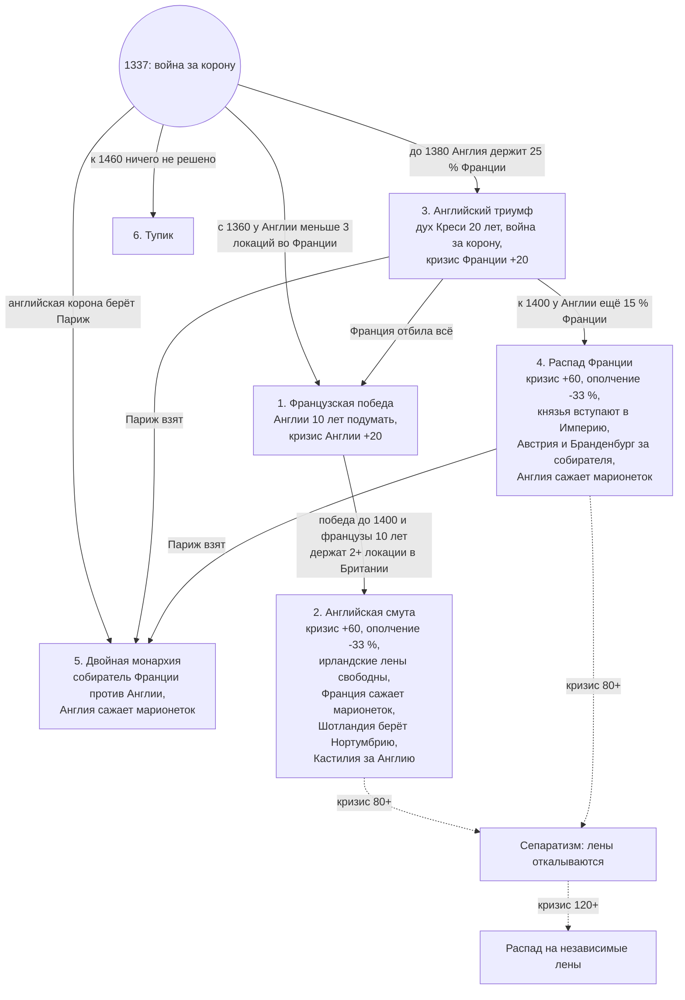

# Geopolicy: сценарии Запада — Франция, Иберия, Британия, Ирландия (реализовано в v0.5.0, 2026-11-06)

Реализованы все ветки (выбор автора 2026-11-06): `in_game/common/scripted_effects/gp_scenarios_west.txt`. Проверку раз в год делает владелец Лондона. Пункты **[баф]** сделаны модификаторами земли под правилом игры «Следы сценариев на земле» (по умолчанию включено); оповещения — строки «Сценарии Запада» на вкладке «Расклад сил», без всплывающих событий. Всё описанное делается рычагами, которые мод уже использует: курс страны (`gp_posture_*`) и подготовленная цель войны, ведущие державы и покровители, оценки целей войны, поводы для войны, мнения, зоны интересов, формируемые страны. Пункты, помеченные **[баф]**, требуют модификатора (страны или земли) — их делать только с разрешения автора.

## 0. Как устроен сценарий

- **Глобальная развилка.** Раз в год мод проверяет условия ветки по ключевым странам и ставит глобальную переменную (`gp_west_hyw_french_victory` и т. п.). Ветка открывается один раз и держится, пока не выполнено условие конца.
- **Что делает ветка:** меняет курс ИИ участников (подготовка войны против конкретной цели, оборона, выжидание), раздаёт роль «собирателя» и покровителей, открывает повод для войны и формируемую страну, меняет мнения и зоны интересов.
- **Случайность.** Ветку выбирает не дата, а исход войн: кто сколько держит. Одна и та же партия может пойти по разным веткам, а ИИ, которому роль досталась, может и не справиться.
- **Сообщение игроку.** На вкладке «Расклад сил» появляется строка «Сценарий региона: …» с описанием ветки (и, по желанию, событие-оповещение).

## 1. Столетняя война (1337 — около 1460)

Старт уже есть: Англия и Франция готовят войну друг против друга, давняя вражда −60, Шотландия в Старом союзе.

| Ветка | Когда открывается | Что происходит |
|---|---|---|
| **1А. Французская победа** (историческая) | к 1460 у Англии в регионе Франция меньше 3 локаций | Англия получает «смутное время» на 10 лет (аналог войны Роз) и курс «восстановление»; её направление сужается до Ирландии. Франция получает направление на Италию раньше («итальянские войны») и тягу к Нидерландам. |
| **1Б. Сокрушительная французская победа** | Англия потеряла континент до 1420, а у Франции 3+ локации в Британии | «Французский плацдарм»: Франция получает повод на английское побережье, Шотландия — подготовку войны против Англии вместе с Францией. Англия становится «безнадёжной» на 15 лет. Уэльс и Нортумбрия получают статус ведущих держав Британии и покровителя Францию; возможен распад Англии (ванильные «Нортумбрия» и «Уэльс»). |
| **1В. Двойная монархия** (английская победа) | Англия держит Париж и 40 % региона Франция | Открывается «Анжуйская империя» (уже есть в моде). Французские княжества (Бургундия, Бретань, Прованс, Окситания) становятся ведущими державами; сильнейшая из них — «собиратель Франции» с поводом «Освободить Францию» против английских земель. Австрия и император получают цель «баланса сил»: сблизиться с французами и выбить Англию с континента (а позже и втянуть Францию в Империю). |
| **1Г. Распад Франции** | у Франции меньше 25 % своего региона (или её нет) | Конкурс лидеров: Бургундия, Прованс/Арелат, Бретань, Окситания. Самая сильная из них получает роль «объединителя» и покровительство над остальными; остальные ищут её защиты. Открываются формируемые «Королевство Бургундия» (есть в моде), ванильные «Бургундия» (Арелат: Прованс, Савойя, Лион, Франш-Конте) и «Окситания». |
| **1Д. Тупик** | к 1460 ни одна ветка не открылась | Перемирия, статус-кво; через 20 лет мира регион «взрывается» новой войной (механизм напряжения уже работает). |

## 2. Ирландия — гонка за остров

| Ветка | Когда | Что происходит |
|---|---|---|
| **2А. Ирландия объединилась** | гэльская страна держит 50 % Ирландии раньше, чем Англия | Открывается ванильная «Ирландия»; объединитель получает союз с Шотландией и Францией (Старый союз шире). **[баф]** «Объединённая Ирландия»: +25 % обороны крепостей на ирландских землях на 50 лет. |
| **2Б. Англия взяла быстро** | Англия держит 75 % Ирландии до 1450 | «Англо-ирландцы»: ирландские земли Англии не получают штрафа удалённости (как свои), формируемая «Пейл» доступна. |
| **2В. Англия взяла поздно** | Англия держит 75 % Ирландии только после 1450 | **[баф/дебаф]** «Национальное сознание»: на ирландских землях неирландского владельца −15 % контроля навсегда — ирландцев оттуда не выбить. Гэльские страны получают повод на возвращение этих земель. |
| **2Г. Переругались** | до 1400 ни одна гэльская страна не держит 30 % | Гэльские страны становятся соперниками за регион (уже работает), Англия получает «право на регион» быстрее. |

## 3. Шотландия — держаться до конца

| Ветка | Когда | Что происходит |
|---|---|---|
| **3А. Старый союз** (по умолчанию) | Шотландия независима, Англия — её угроза | Франция получает цель «защищать Шотландию» (её защита при нападении Англии). Шотландия не выбирает «мир» и «выжидание» против Англии, только оборону и общий фронт. **[ограничение]** «Никогда не сдаваться» напрямую не задать (решение о мире — движок); можно поднять военный энтузиазм Шотландии в оборонительной войне с Англией через повод. |
| **3Б. Шотландия побеждает** | Шотландия держит 40 % Британии | Открывается «Альба» (есть в моде) и направление на Ирландию; Англия — «безнадёжна». |

## 4. Иберия

| Ветка | Когда | Что происходит |
|---|---|---|
| **4А. Реконкиста завершена** (историческая) | Гранады нет, Кастилия держит 55 % Иберии | Кастилия получает направление на Магриб и колониальную тягу; Франция начинает «баланс сил» в пользу Португалии и Арагона (уже работает). |
| **4Б. Португальская Иберия** | Португалия держит 40 % Иберии | Португалия получает дорогу к ванильной «Испании» (75 % Иберии) и роль собирателя полуострова; Кастилия — «смутное время». |
| **4В. Арагонское море** | Арагон держит Сицилию или Сардинию и 3+ локации в Италии | Арагон получает направление на Италию и Магриб, «Средиземноморская корона» (добавлена в v0.4); Кастилия и Арагон остаются соперниками. |
| **4Г. Гранада держится** | к 1450 Гранада жива и в союзе с Марокко | Марокко получает направление на Иберию и цель защищать Гранаду; Кастилия — подготовку войны против Гранады с повторами. |

## 5. Извне — кто вмешивается

- **Австрия и Империя**: при ветке 1В или 1Г — сближение с французскими княжествами, цель выбить Англию с континента, позже — включить Францию в Империю.
- **Бургундия**: при слабой Франции — путь к Нидерландам (ванильные `NED`/`BEL`) и «Королевству Бургундия».
- **Папство и Италия**: при победе Франции — «итальянские войны» (направление Франции на Италию).

## 6. Что нужно от автора

1. Какие ветки делать первыми (предложение: 1А–1Г, 2А–2В, 3А, 4А–4В).
2. Разрешить ли **[баф]**-пункты: оборона «Объединённой Ирландии» и «Национальное сознание» (это модификаторы земель, как «Природные рубежи»).
3. Нужны ли события-оповещения при открытии ветки или хватит строки на вкладке «Расклад сил».

## 7. Как сделано (v0.5.0)

- Глобальные переменные `gp_sc_hyw` (1 — французская победа, 2 — сокрушительная, 3 — двойная монархия, 4 — распад Франции, 5 — тупик), `gp_sc_ireland` (1 — объединена, 2 — англо-ирландцы, 3 — национальное сознание), `gp_sc_ireland_quarrel`, `gp_sc_scotland` (1 — Старый союз, 2 — Шотландия победила), `gp_sc_reconquista`, `gp_sc_portugal`, `gp_sc_aragon_sea`, `gp_sc_granada_holds`, `gp_sc_france_leader` (собиратель Франции).
- «Английская корона» — владелец Лондона, «французская» — владелец Парижа (так ветки переживают смену тегов: Великобритания, Анжуйская империя).
- Сценарная война: повод «Война сценария» (`gp_cb_scenario_war`) против страны из `var:gp_sc_cb_target` и список целей `gp_target_scenario_war`; ИИ на 6 лет переходит в подготовку этой войны. Такие цели не сдерживаются правилом «свой регион до 1600».
- «Надломленная» держава (`gp_sc_broken`, 15 лет) считается безнадёжной: обороняется, не ведёт регион.
- Союзники по сценарию (`gp_obj_scenario_ally`): Австрия — к собирателю Франции, французская корона — к Шотландии (Старый союз), Марокко — к Гранаде.
- Направления по сценарию добавляются к обычным: Англия после 1А — только Ирландия, Франция после 1А — Италия и Нидерланды, Бургундия при 1В/1Г — Италия и Нидерланды, победившая Шотландия — Ирландия, Кастилия после Реконкисты — Магриб, Арагон-море — Италия и Магриб, Марокко при 4Г — Иберия.
- Шотландия в ветке 3А: «мир» −40, «выжидание» −20, «оборона» +20 при выборе курса.
- Англо-ирландцы (2Б): ирландские земли владельца Лондона не получают штрафа удалённости. Национальное сознание (2В): ирландские земли неирландского владельца −15 % контроля, гэльские страны получают повод против Англии. Объединённая Ирландия (2А): крепости +25 % на 50 лет, давняя дружба с Шотландией и Францией.

## 8. Столетняя война v2 (v0.7.0, заменяет таблицу §1)

По описанию автора (2026-11-06): окна по времени, смута проигравшего, марионетки вместо завоевания, французские князья под крылом Империи.

- **Марионетки.** Победитель в ветках 2, 4, 5 получает отметку «кукловод»: повод «Установить господство» (вассал вместо аннексии) ему доступен уже через год после войны и стоит в списке целей выше (+15).
- **Модификаторы** (под правилом «Следы сценариев на земле»): «Дух Креси» (+10 % морали армии, 20 лет), «Английская смута» и «Распад французской короны» (ополчение −33 %, людские ресурсы −25 %, 20 лет).

## 9. Распад держав (v0.7.0, все регионы, `gp_crisis_effects.txt`)

Очки кризиса страны: +1 за каждую свою локацию в руках врага на ежегодной проверке (до 20), +10 если враг держит столицу, +20 за проигранную войну, удары сценариев; −6 за мирный год, −10 за выигранную войну.

| Очки | Что происходит |
|---|---|
| 40+ | окраины (земли вне домашнего региона) выходят из-под контроля: −15 % контроля |
| 80+ | «Сепаратизм»: ополчение −25 %, людские ресурсы −20 %; каждый год с вероятностью 30 % откалывается лен с окраин |
| 120+ | распад: до шести ленов сразу становятся независимыми (сначала окраины, потом домашний регион вдали от столицы), кризис −50 |

Лен — страна, у которой есть коренные земли в наших локациях, но которой сейчас нет (ванильное `create_country_from_cores_in_our_locations`). Правило игры «Распад держав» (по умолчанию включено).
