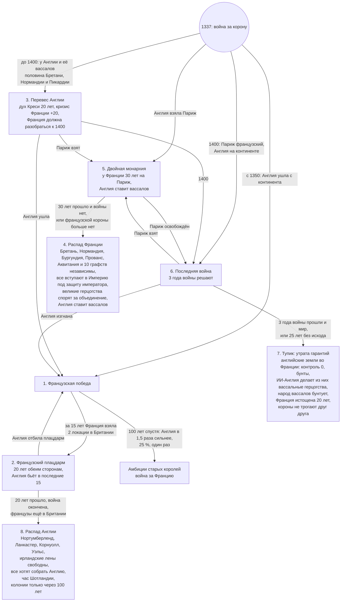
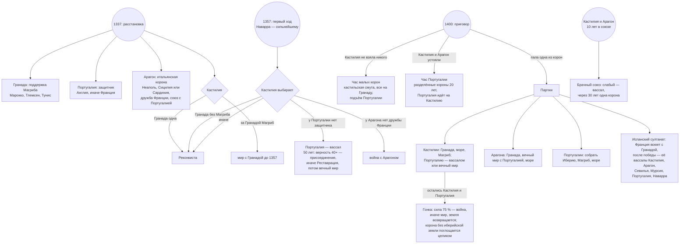

# Geopolicy: сценарии Запада — Франция, Иберия, Британия, Ирландия (реализовано в v0.5.0, 2026-11-06)

Реализованы все ветки (выбор автора 2026-11-06): `in_game/common/scripted_effects/gp_scenarios_west.txt`. Проверку раз в год делает владелец Лондона. Пункты **[баф]** сделаны модификаторами земли под правилом игры «Следы сценариев на земле» (по умолчанию включено); оповещения — строки «Сценарии Запада» на вкладке «Расклад сил», без всплывающих событий. Всё описанное делается рычагами, которые мод уже использует: курс страны (`gp_posture_*`) и подготовленная цель войны, ведущие державы и покровители, оценки целей войны, поводы для войны, мнения, зоны интересов, формируемые страны. Пункты, помеченные **[баф]**, требуют модификатора (страны или земли) — их делать только с разрешения автора.

## 0. Как устроен сценарий

- **Глобальная развилка.** Раз в год мод проверяет условия ветки по ключевым странам и ставит глобальную переменную (`gp_west_hyw_french_victory` и т. п.). Ветка открывается один раз и держится, пока не выполнено условие конца.
- **Что делает ветка:** меняет курс ИИ участников (подготовка войны против конкретной цели, оборона, выжидание), раздаёт роль «собирателя» и покровителей, открывает повод для войны и формируемую страну, меняет мнения и зоны интересов.
- **Случайность.** Ветку выбирает не дата, а исход войн: кто сколько держит. Одна и та же партия может пойти по разным веткам, а ИИ, которому роль досталась, может и не справиться.
- **Сообщение игроку.** На вкладке «Расклад сил» появляется строка «Сценарий региона: …» с описанием ветки (и, по желанию, событие-оповещение).

## 1. Столетняя война (1337 — около 1460)

Старт уже есть: Англия и Франция готовят войну друг против друга, давняя вражда −60, Шотландия в Старом союзе.

| Ветка | Когда открывается | Что происходит |
|---|---|---|
| **1А. Французская победа** (историческая) | к 1460 у Англии в регионе Франция меньше 3 локаций | Англия получает «смутное время» на 10 лет (аналог войны Роз) и курс «восстановление»; её направление сужается до Ирландии. Франция получает направление на Италию раньше («итальянские войны») и тягу к Нидерландам. |
| **1Б. Сокрушительная французская победа** | Англия потеряла континент до 1420, а у Франции 3+ локации в Британии | «Французский плацдарм»: Франция получает повод на английское побережье, Шотландия — подготовку войны против Англии вместе с Францией. Англия становится «безнадёжной» на 15 лет. Уэльс и Нортумбрия получают статус ведущих держав Британии и покровителя Францию; возможен распад Англии (ванильные «Нортумбрия» и «Уэльс»). |
| **1В. Двойная монархия** (английская победа) | Англия держит Париж и 40 % региона Франция | Открывается «Анжуйская империя» (уже есть в моде). Французские княжества (Бургундия, Бретань, Прованс, Окситания) становятся ведущими державами; сильнейшая из них — «собиратель Франции» с поводом «Освободить Францию» против английских земель. Австрия и император получают цель «баланса сил»: сблизиться с французами и выбить Англию с континента (а позже и втянуть Францию в Империю). |
| **1Г. Распад Франции** | у Франции меньше 25 % своего региона (или её нет) | Конкурс лидеров: Бургундия, Прованс/Арелат, Бретань, Окситания. Самая сильная из них получает роль «объединителя» и покровительство над остальными; остальные ищут её защиты. Открываются формируемые «Королевство Бургундия» (есть в моде), ванильные «Бургундия» (Арелат: Прованс, Савойя, Лион, Франш-Конте) и «Окситания». |
| **1Д. Тупик** | к 1460 ни одна ветка не открылась | Перемирия, статус-кво; через 20 лет мира регион «взрывается» новой войной (механизм напряжения уже работает). |

## 2. Ирландия — гонка за остров

| Ветка | Когда | Что происходит |
|---|---|---|
| **2А. Ирландия объединилась** | гэльская страна держит 50 % Ирландии раньше, чем Англия | Открывается ванильная «Ирландия»; объединитель получает союз с Шотландией и Францией (Старый союз шире). **[баф]** «Объединённая Ирландия»: +25 % обороны крепостей на ирландских землях на 50 лет. |
| **2Б. Англия взяла быстро** | Англия держит 75 % Ирландии до 1450 | «Англо-ирландцы»: ирландские земли Англии не получают штрафа удалённости (как свои), формируемая «Пейл» доступна. |
| **2В. Англия взяла поздно** | Англия держит 75 % Ирландии только после 1450 | **[баф/дебаф]** «Национальное сознание»: на ирландских землях неирландского владельца −15 % контроля навсегда — ирландцев оттуда не выбить. Гэльские страны получают повод на возвращение этих земель. |
| **2Г. Переругались** | до 1400 ни одна гэльская страна не держит 30 % | Гэльские страны становятся соперниками за регион (уже работает), Англия получает «право на регион» быстрее. |

## 3. Шотландия — держаться до конца

| Ветка | Когда | Что происходит |
|---|---|---|
| **3А. Старый союз** (по умолчанию) | Шотландия независима, Англия — её угроза | Франция получает цель «защищать Шотландию» (её защита при нападении Англии). Шотландия не выбирает «мир» и «выжидание» против Англии, только оборону и общий фронт. **[ограничение]** «Никогда не сдаваться» напрямую не задать (решение о мире — движок); можно поднять военный энтузиазм Шотландии в оборонительной войне с Англией через повод. |
| **3Б. Шотландия побеждает** | Шотландия держит 40 % Британии | Открывается «Альба» (есть в моде) и направление на Ирландию; Англия — «безнадёжна». |

## 4. Иберия

| Ветка | Когда | Что происходит |
|---|---|---|
| **4А. Реконкиста завершена** (историческая) | Гранады нет, Кастилия держит 55 % Иберии | Кастилия получает направление на Магриб и колониальную тягу; Франция начинает «баланс сил» в пользу Португалии и Арагона (уже работает). |
| **4Б. Португальская Иберия** | Португалия держит 40 % Иберии | Португалия получает дорогу к ванильной «Испании» (75 % Иберии) и роль собирателя полуострова; Кастилия — «смутное время». |
| **4В. Арагонское море** | Арагон держит Сицилию или Сардинию и 3+ локации в Италии | Арагон получает направление на Италию и Магриб, «Средиземноморская корона» (добавлена в v0.4); Кастилия и Арагон остаются соперниками. |
| **4Г. Гранада держится** | к 1450 Гранада жива и в союзе с Марокко | Марокко получает направление на Иберию и цель защищать Гранаду; Кастилия — подготовку войны против Гранады с повторами. |

## 5. Извне — кто вмешивается

- **Австрия и Империя**: при ветке 1В или 1Г — сближение с французскими княжествами, цель выбить Англию с континента, позже — включить Францию в Империю.
- **Бургундия**: при слабой Франции — путь к Нидерландам (ванильные `NED`/`BEL`) и «Королевству Бургундия».
- **Папство и Италия**: при победе Франции — «итальянские войны» (направление Франции на Италию).

## 6. Что нужно от автора

1. Какие ветки делать первыми (предложение: 1А–1Г, 2А–2В, 3А, 4А–4В).
2. Разрешить ли **[баф]**-пункты: оборона «Объединённой Ирландии» и «Национальное сознание» (это модификаторы земель, как «Природные рубежи»).
3. Нужны ли события-оповещения при открытии ветки или хватит строки на вкладке «Расклад сил».

## 7. Как сделано (v0.5.0)

- Глобальные переменные `gp_sc_hyw` (1 — французская победа, 2 — сокрушительная, 3 — двойная монархия, 4 — распад Франции, 5 — тупик), `gp_sc_ireland` (1 — объединена, 2 — англо-ирландцы, 3 — национальное сознание), `gp_sc_ireland_quarrel`, `gp_sc_scotland` (1 — Старый союз, 2 — Шотландия победила), `gp_sc_reconquista`, `gp_sc_portugal`, `gp_sc_aragon_sea`, `gp_sc_granada_holds`, `gp_sc_france_leader` (собиратель Франции).
- «Английская корона» — владелец Лондона, «французская» — владелец Парижа (так ветки переживают смену тегов: Великобритания, Анжуйская империя).
- Сценарная война: повод «Война сценария» (`gp_cb_scenario_war`) против страны из `var:gp_sc_cb_target` и список целей `gp_target_scenario_war`; ИИ на 6 лет переходит в подготовку этой войны. Такие цели не сдерживаются правилом «свой регион до 1600».
- «Надломленная» держава (`gp_sc_broken`, 15 лет) считается безнадёжной: обороняется, не ведёт регион.
- Союзники по сценарию (`gp_obj_scenario_ally`): Австрия — к собирателю Франции, французская корона — к Шотландии (Старый союз), Марокко — к Гранаде.
- Направления по сценарию добавляются к обычным: Англия после 1А — только Ирландия, Франция после 1А — Италия и Нидерланды, Бургундия при 1В/1Г — Италия и Нидерланды, победившая Шотландия — Ирландия, Кастилия после Реконкисты — Магриб, Арагон-море — Италия и Магриб, Марокко при 4Г — Иберия.
- Шотландия в ветке 3А: «мир» −40, «выжидание» −20, «оборона» +20 при выборе курса.
- Англо-ирландцы (2Б): ирландские земли владельца Лондона не получают штрафа удалённости. Национальное сознание (2В): ирландские земли неирландского владельца −15 % контроля, гэльские страны получают повод против Англии. Объединённая Ирландия (2А): крепости +25 % на 50 лет, давняя дружба с Шотландией и Францией.

## 8. Столетняя война v3 (v0.8.0, заменяет §1 и v2 из v0.7.0)

По описанию автора (2026-11-06, вторая правка): у каждой развилки свой срок, проигравшая корона распадается на исторические земли, победитель ставит вассалов вместо аннексии. Код: `in_game/common/scripted_effects/gp_scenarios_hyw.txt`, проверка раз в год у владельца Лондона.

**Короны.** Английская и французская корона — страны, владевшие Лондоном и Парижем при первой проверке (ENG и FRA). Пока корона жива, она остаётся короной, где бы ни была её столица; если умерла — корону заменяет владелец Лондона / Парижа.

| Состояние | Срок | Что делает |
|---|---|---|
| Война за корону | до 1400 | обе короны готовят войну друг с другом (исторические «подготовки») |
| 3. Перевес Англии | до 1400 | «Дух Креси» Англии (+10 % морали, 20 лет), кризис Франции +20; Франция каждый год готовит войну с Англией |
| 5. Двойная монархия | 30 лет | французская корона (или сильнейшая свободная французская страна) воюет за Париж, остальные княжества опираются на неё, Австрия дружит с ней; Англия ставит вассалов. Если на 30-й год идёт война — ждём её конца |
| 4. Распад Франции | навсегда | см. §9: корона сохраняет только область своей столицы (Иль-де-Франс, если Париж её); все свободные французские страны, кроме короны, вступают в Империю, император — их покровитель; Франция-обрубок, Бретань, Нормандия, Бургундия, Прованс и Аквитания — претенденты на объединение |
| 6. Последняя война | 3 года войны, не больше 25 лет | обе короны готовят войну; считаются только годы, когда они воюют друг с другом; исход — по итогу последнего мира |
| 7. Тупик | навсегда | «Утраченные гарантии» на всех землях английской короны во Франции (макс. контроль −100 %, беспорядки +50 %); «Беспокойный лен» на французских землях её вассалов (беспорядки +50 %, народ легче уходит к мятежникам); ИИ-Англия делает из своих французских земель вассалов: Нормандию, Бретань, Аквитанию, Пикардию, Анжу; Франция — «Усталость Франции» (ополчение и людские ресурсы −15 %, 20 лет) и курс восстановления; короны не берут целей друг у друга и у вассалов друг друга (×0,15), но и не мирятся |
| 1. Французская победа | 15 лет на высадку, 100 лет до амбиций | Англия — островная держава: цели на континенте ×0,3 (Германия и Нидерланды ×0,7 — там она работает через вассалов), дружит и защищает свободные страны Франции и тех в Германии, кому угрожает Франция; «Островное уединение» на 50 лет (дальность колонизации −100 %, ИИ не колонизирует), потом сразу идёт в колонии. Франция готовит высадку |
| 2. Французский плацдарм | 20 лет | Англия 5 лет восстанавливается, потом 15 лет готовит войну с Францией; если на 20-й год идёт война — ждём её конца |
| 8. Распад Англии | навсегда | см. §9; Англия и её наследники — претенденты на Британию, «Островное уединение» на 100 лет; Франция ставит вассалов; Уэльс под покровительством Франции; Кастилия за Англию; «Час Шотландии» (§10) |

**Что выбрано за автора** (поправить можно одной строкой в коде):
- «Область справа от Нормандии» — Пикардия (Амьен, Аррас, Кале). Иль-де-Франс не взят: там Париж, его захват — отдельная ветка.
- «Последняя война» — три года войны между коронами в сумме; если они так и не воюют, тупик наступает через 25 лет.
- «Старые амбиции» — проверка с 100-го по 150-й год после победы: первый же год, когда Англия в 1,5 раза сильнее Франции, бросается кубик 25 %, один раз.
- «Англия сильнее» — ванильная сила страны (`country_strength`).

## 9. Распад держав (v0.7.0, все регионы, `gp_crisis_effects.txt`)

Очки кризиса страны: +1 за каждую свою локацию в руках врага на ежегодной проверке (до 20), +10 если враг держит столицу, +20 за проигранную войну, удары сценариев; −6 за мирный год, −10 за выигранную войну.

| Очки | Что происходит |
|---|---|
| 40+ | окраины (земли вне домашнего региона) выходят из-под контроля: −15 % контроля |
| 80+ | «Сепаратизм»: ополчение −25 %, людские ресурсы −20 %; каждый год с вероятностью 30 % откалывается лен с окраин |
| 120+ | распад: до шести ленов сразу становятся независимыми (сначала окраины, потом домашний регион вдали от столицы), кризис −50 |

Лен — страна, у которой есть коренные земли в наших локациях, но которой сейчас нет (ванильное `create_country_from_cores_in_our_locations`). Правило игры «Распад держав» (по умолчанию включено).

**v0.8: распад корон на исторические земли.** Французская и английская корона при кризисе 120+ (или в ветках 4 и 8 Столетней войны) распадаются не на случайные лены, а на свои исторические земли, один раз за игру. Земля короны в области отходит указанной стране: мёртвая страна поднимается из ядер, которые ей дают, живая получает землю и, если была вассалом короны, свободу. Область столицы короны остаётся за ней.

| Корона | Область → страна |
|---|---|
| Франция | Бретань → BRI, Нормандия → NRM, Бургундия → BUR, Прованс → PRO, Гиень, Гасконь и Пуату → AQN (Аквитания), Лангедок → TOU, Анжу → ANJ, Шампань → CHP, Пикардия → PIC, Овернь → AUV, Орлеане → ORL, Савойя (Валентинуа, Вьеннуа) → DAU, Лионне → FRZ, Лотарингия → LOR, Франш-Конте → FCB |
| Англия | Нортумбрия → NOL (Нортумберленд), Мидлендс → LAN (Ланкастер), Западная Англия → CRN (Корнуолл), Уэльс → WLS, шотландские области → SCO; Хоум-Каунтис и Восточная Англия остаются короне |

## 10. Острова — Ирландия и Шотландия (v0.8.0)

По описанию автора: ирландцы всегда хотят только свой остров, шотландцы — уничтожить Англию; потом оба идут в колонии, потому что на континент лезть тяжело.

| Кто | Пока | Потом |
|---|---|---|
| Ирландцы (гэльская страна со столицей в Ирландии) | цели без ирландской земли ×0,1; колоний нет | с 1437 года, если держат 90 % острова, — идут в колонии |
| Шотландцы (столица в шотландских областях) | колоний нет | Шотландия выиграла Британию (40 % региона) или прошло 30 лет после распада Англии — идут в колонии |
| Шотландия при распаде Англии | «Час Шотландии» 20 лет: +10 % морали, +20 % эффективности военного счёта; право на объединение Британии (повод «Объединить регион») на 20 лет, война с английской короной, Нортумбрия в зонах интересов, цели с землёй в Британии ×1,5 | — |
| Англия после французской победы | без колоний 50 лет | сразу в колонии |
| Англия и наследники после распада Англии | без колоний 100 лет | обычные правила |

Запрет колоний для ИИ — ванильные предпочтения «избегать колонизации» (Америка, Африка, Юго-Восточная Азия) и снятие «колониальных амбиций»; для всех — «Островное уединение» (дальность колонизации −100 %) под правилом «Следы сценариев».

## 11. Иберийские шахматы (v0.9.0)

По описанию автора (2026-11-06): четыре короны — Кастилия, Арагон, Португалия, Гранада — каждая со своей целью, к 1400 году должно остаться не больше трёх; Наварра достаётся сильнейшему из Кастилии и Арагона. Код: `in_game/common/scripted_effects/gp_scenarios_iberia.txt`, проверка раз в год у владельца Лондона. Цель каждой короны пересматривается ежегодно — по тому, кто ещё стоит, кто с кем в союзе и кто за кем стоит. Цель видна на вкладке («Наша цель») и в подсказке режима карты «Расклад сил».

| Корона | Цели по порядку |
|---|---|
| Кастилия | до 1357: Реконкиста, если Гранада одна, иначе мир с ней; с 1357: Гранада без Магриба → Португалия без защитника (вассал, повод «Подчинение по сценарию») → Арагон без дружбы Франции → Гранада → Арагон → гонка с Португалией / вечный мир / море и Магриб |
| Арагон | итальянская корона (Неаполь вассалом через «Подчинение по сценарию», кукловод в Италии) → с короной или с 1400: война с Кастилией → без Кастилии: Гранада → море, вечный мир с Португалией |
| Португалия | защитник (союз с Англией; англичане защищают Португалию) → держать границу → в час малых корон на Гранаду → в час Португалии на Кастилию → без Кастилии и Арагона: Гранада, собрать Иберию (право на объединение 20 лет), море и Магриб |
| Гранада | поддержка Магриба (Марокко — покровитель, Марокко, Тлемсен и Тунис её защищают) → с поддержкой с 1357: война с Кастилией → треть Иберии: испанский султанат → без поддержки после 1400: последний рубеж |

**Модификаторы** (под правилом «Следы сценариев»): «Помощь Магриба» (Гранада при поддержке: людские ресурсы +20 %, мораль +5 %), «Благосклонность Франции» (Арагон при мнении Франции 150+: людские ресурсы +10 %, довольство сословий +5 %), «Арагонская корона Италии» (25 лет: ополчение +10 %, постройка кораблей +15 %), «Кастильская смута» (20 лет: макс. контроль −15 %, ополчение −10 %), «Разделённые короны» (Кастилия и Арагон, 20 лет: −10 % и −10 %), «Подъём Португалии» (20 лет: макс. контроль +10 %, довольство сословий +10 %, осады +15 %, мораль +5 %), «Португальская гордость» (вассал Кастилии: верность −15), «Реставрация» (20 лет: оборона +25 %, мораль +10 %), «Чужая корона» (земля по ту сторону Пиренеев: контроль −50 %, беспорядки +25 %).

**Франция и Испания.** Франция не лезет в Иберию (цели там ×0,4, кроме войны с султанатом), иберийские короны не берут землю во Франции (×0,4) — только влияние. Земля по ту сторону Пиренеев под чужой короной получает «Чужую корону».

**Что выбрано за автора** (поправить одной строкой):
- Союз с Арагоном тоже считается защитой Португалии.
- «Испанский султанат» — Гранада держит 35 % Иберии, а Кастилии больше нет.
- Брачный союз — 10 лет союза Кастилии и Арагона; вассалом становится только корона под управлением ИИ; одна корона — через 30 лет.
- Гонка Кастилии и Португалии считается по ванильной силе страны; порог войны — 75 %.
- Присоединение по сценарию (Португалия через 50 лет, младшая корона, гонка) — только стран под управлением ИИ.

## 12. Союзы только между друзьями и «Деревянные стены» (v0.9.0)

- **Союзы.** Союз можно предложить, только если обе страны думают друг о друге не ниже чем на 100. Сделано заменой ванильного отношения «союз» (`in_game/common/scripted_relations/gp_alliance.txt`, `REPLACE:alliance` — копия ванили 1.4.7 с одним добавленным условием). Уже заключённые союзы не рвутся. Правило игры «Союзы только между друзьями» (по умолчанию включено). После каждого патча игры файл надо сверить с ванилью.
- **Деревянные стены.** После французской победы английская корона на 100 лет строит и содержит корабли дешевле (−25 %) и быстрее (+25 %): высадка французов становится редкостью; повторить её сможет разве что игрок.

## 13. Режим карты «Расклад сил» (v0.9.0)

Новый режим карты в группе «Геополитика» (`in_game/gfx/map/map_modes/gp_map_modes.txt`): страны, которые вкладка «Расклад сил» показывает для региона игрока (претенденты, пришельцы, сильнейшие державы макрорегиона), — в своих цветах, остальные серые. При наведении: страна, её цель (как «Наша цель») и курс.

Пока не сделано (следующий шаг после проверки в игре): список целей слева, который подсвечивает на карте нужные страны, и значки-флажки над странами с действиями. Режим карты не видит, на что наведена мышь в интерфейсе, а значки на карте задаёт движок — это надо пробовать отдельно.
